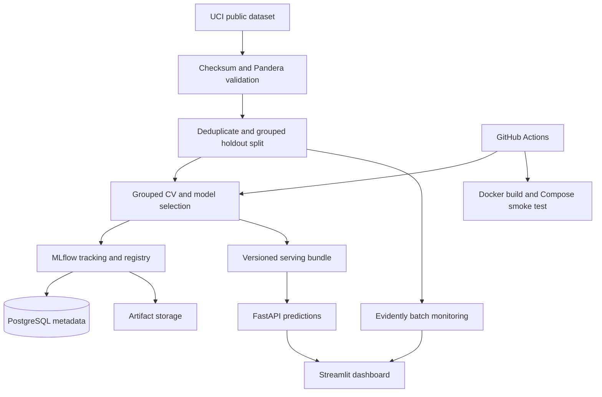
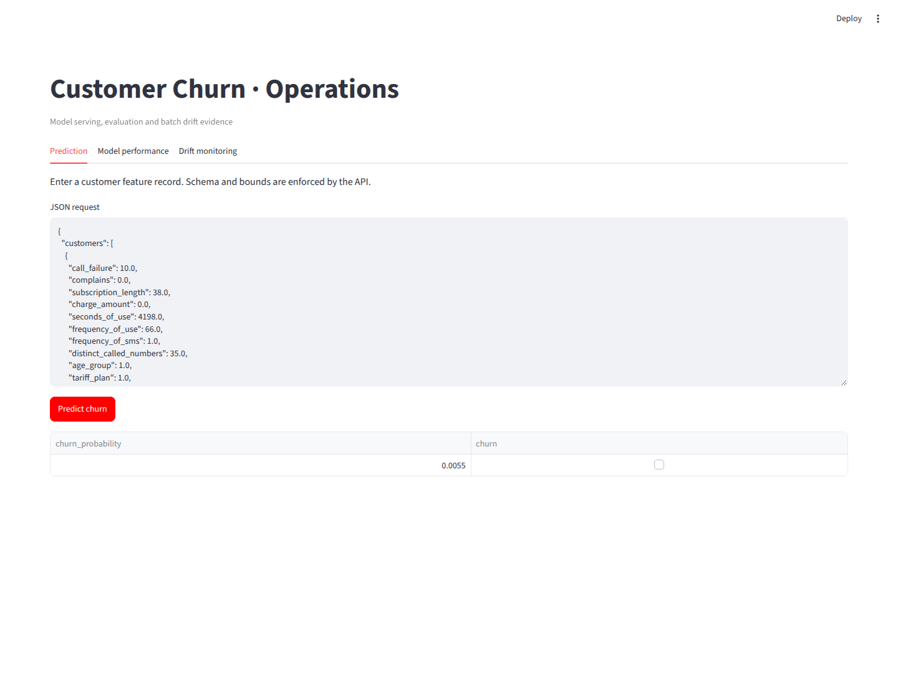
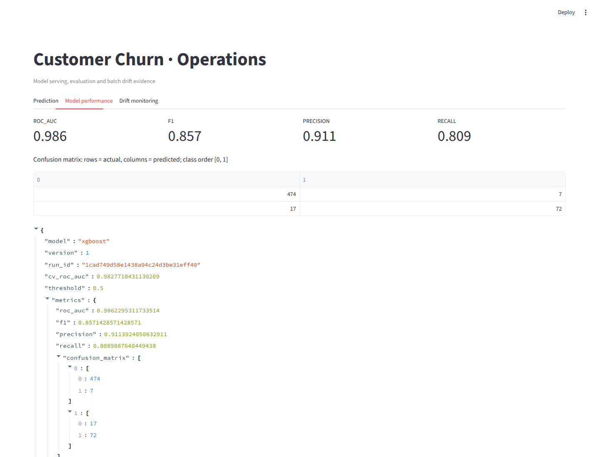
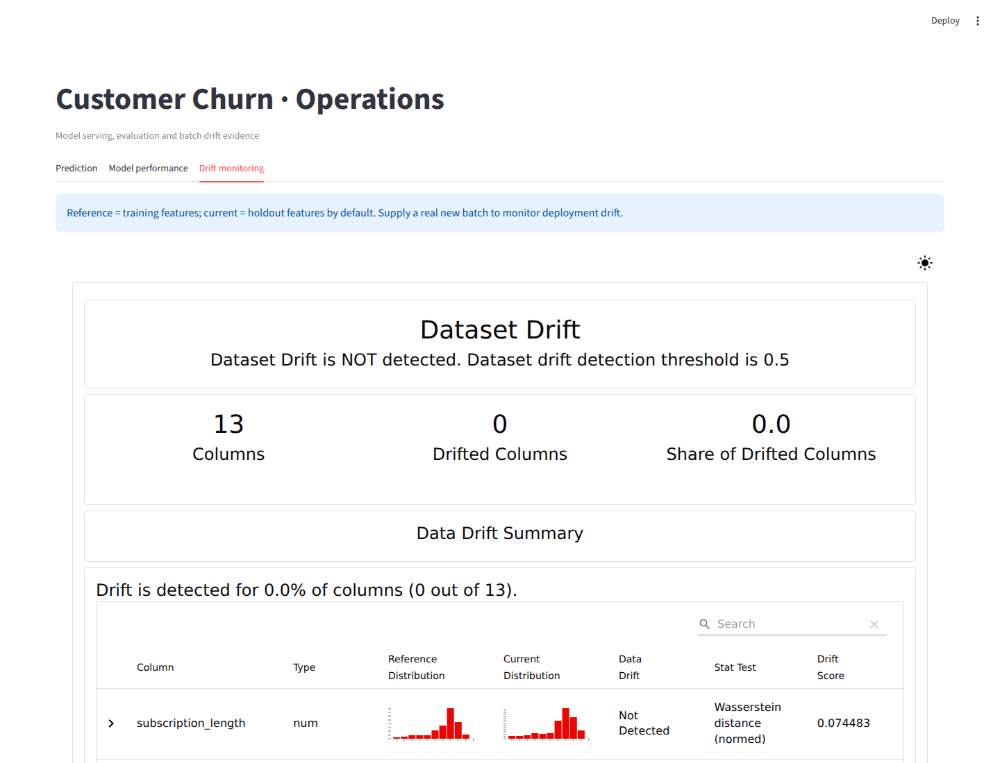

# Customer Churn MLOps Platform

An end-to-end, CPU-friendly ML platform by **Saad Mesbah**, Data Science engineering student at ESI Rabat (2027). Built for a reproducible local deployment and a reviewable PFE portfolio.

**Production-oriented reference implementation:** real model training and registry, validated serving, drift evidence and CI. This is not a claim of production traffic, uptime or cloud deployment. See [verification](docs/verification.md).

## Architecture



## Quick start

Requirements: Python 3.11+ (tested on 3.12), [uv](https://docs.astral.sh/uv/), internet access for first ingestion. Everything runs on CPU.

```bash
git clone https://github.com/saadmesbah/customer-churn-mlops-platform.git
cd customer-churn-mlops-platform
uv sync --frozen
uv run python -m churn.train
uv run python -m churn.monitor
uv run uvicorn churn.api:app --host 127.0.0.1 --port 8000 --log-config logging.json
# In another terminal:
uv run streamlit run dashboard/app.py
```

Open the dashboard at http://localhost:8501 and interactive API docs at http://localhost:8000/docs. Local runs use SQLite for MLflow metadata; inspect them with `uv run mlflow ui --backend-store-uri sqlite:///mlflow.db`. All installed dependency versions and hashes are recorded in `uv.lock`. Pandas is constrained below 3 because the tested Evidently version imports an internal API removed in Pandas 3.

## Docker Compose

```bash
cp .env.example .env
# Replace POSTGRES_PASSWORD with a random hex value. Never commit .env.
docker compose up --build -d
docker compose logs -f train
curl --fail http://localhost:8000/health
# Stop services; retain data:
docker compose down
```

Six services: PostgreSQL, MLflow, training, monitoring, API and dashboard. Training and monitoring are one-shot jobs; successful exit is expected. Service health checks gate startup. MLflow stores metadata in PostgreSQL and serves artifacts from its own named volume; training clients do not need a shared artifact path. Models and reports use separate volumes. Host ports bind to loopback. The application runs as an unprivileged user.

First startup downloads dependencies and the public dataset. To rerun training explicitly: `docker compose run --rm train`, then `docker compose run --rm monitor` and `docker compose restart api dashboard`. The API loads an immutable local model bundle at startup; changing the MLflow champion alias alone does not hot-swap a running process. `docker compose down -v` deletes all local state.

## Dataset and reproducibility

[UCI Iranian Churn](https://archive.ics.uci.edu/dataset/563/iranian+churn+dataset), 2020, DOI [10.24432/C5JW3Z](https://doi.org/10.24432/C5JW3Z), licensed [CC BY 4.0](https://creativecommons.org/licenses/by/4.0/). The software uses the MIT license; that does not relicense the dataset.

The data contains 3,150 customer records, 13 predictors and a binary target. According to UCI, features aggregate the first nine months and churn is observed at month twelve, leaving a three-month planning gap. No customer identifiers are used. Ingestion normalizes whitespace, checks a pinned SHA-256 for the upstream ZIP, validates the schema, caches the CSV, and verifies its checksum on reuse. Data and model binaries are not committed.

Actual data inspection found 300 exact duplicate rows and 14 predictor profiles with conflicting labels. Exact rows are removed, while conflicting labels are retained. **Identical predictor profiles stay in the same group** for both holdout splitting and cross-validation. After deduplication there are 2,850 records: 2,280 for training and 570 for testing. UCI describes charge amount as 0–9, but seven raw rows contain 10; validation explicitly permits 0–10. These decisions are logged and documented rather than silently discarding inconvenient records.

## Model selection and actual results

All imputation and scaling are inside the scikit-learn Pipeline, fitted separately in every CV fold. Three-fold `StratifiedGroupKFold` tunes two logistic-regression configurations and four XGBoost configurations (18 CV fits total). A five-fold stratified grouped splitter supplies one deterministic approximately 20% holdout. Seed: 42. Threshold: 0.5, fixed before evaluation.

Selection criterion: highest mean **training CV ROC-AUC** among candidates with CV ROC-AUC ≥ 0.75; deterministic model-name tiebreak. No holdout metric is used for selection or promotion. If nothing qualifies, training fails without registering a model. The winner is refit on all training data by GridSearchCV, evaluated once on holdout, registered as `customer-churn`, and assigned the `champion` alias. Both candidate models, CV scores, best parameters, input signatures, dataset manifests and final evaluation are tracked.

| Candidate | Mean CV ROC-AUC |
|---|---:|
| Logistic regression | 0.9353 |
| XGBoost | 0.9828 |

| Winner holdout metric | Actual value |
|---|---:|
| ROC-AUC | 0.9862 |
| F1 | 0.8571 |
| Precision | 0.9114 |
| Recall | 0.8090 |

Confusion matrix (actual rows, predicted columns; order non-churn, churn): `[[474, 7], [17, 72]]`. Evidence is in [evidence/evaluation.json](evidence/evaluation.json). These are benchmark results, not a forecast of live business performance. No timestamps or customer IDs are available for longitudinal evaluation; a time-based deployment test and business-cost calibration remain necessary before operational use.

## API

- `GET /health`: readiness (200), or 503 if the model is absent or fails integrity checks.
- `GET /model-info`: model, version, run ID, schema, threshold and actual evaluation.
- `POST /predict`: 1–1,000 customer records, probabilities and threshold decisions.

```bash
curl --fail http://localhost:8000/model-info
curl --fail -X POST http://localhost:8000/predict \
  -H 'Content-Type: application/json' --data @artifacts/example.json
```

```json
{"customers":[{"call_failure":2,"complains":0,"subscription_length":30,"charge_amount":3,"seconds_of_use":4000,"frequency_of_use":80,"frequency_of_sms":10,"distinct_called_numbers":20,"age_group":3,"tariff_plan":1,"status":1,"age":35,"customer_value":100}]}
```

Invalid, missing, out-of-range or extra fields return FastAPI's structured 422 response. Non-finite inputs are rejected. Prediction logs contain batch size, latency and model version, without raw customer features. The artifact SHA-256 detects accidental corruption; it is not an authenticity signature. Joblib and cloudpickle artifacts must come from a trusted training pipeline.

## Monitoring

```bash
uv run python -m churn.monitor \
  --reference artifacts/reference.csv \
  --current artifacts/current.csv --output reports
```

Evidently produces standalone HTML and JSON with per-feature statistics, thresholds, and drifted-column counts. The default compares training and holdout covariates: the verified report flags **0/13** drifted columns. It is a reproducibility check, not production surveillance. The integration test also creates an explicitly simulated seconds-of-use shift and checks its detection. Provide an independently collected, schema-compatible CSV to monitor new batches. This implementation does not persist prediction payloads or infer accuracy without delayed ground truth. Drift triggers review, not automatic retraining or promotion.

## Dashboard

Individual/batch prediction editor, four evaluation metrics, confusion matrix, model metadata and embedded Evidently report. Screenshots show actual local execution:





## Tests and delivery

```bash
uv run ruff check .
uv run ruff format --check .
uv run pytest --cov=churn --cov-report=term-missing
```

Tests cover invalid schemas and requests, reproducible ingestion and checksums, missing/corrupt artifacts, known metric values, real training, registry alias, disjoint profiles, API/model prediction parity and drift reports. Integration tests need internet on first ingestion and write evidence files. Unit tests mock the network.

GitHub Actions separates lint/unit tests, the real lifecycle integration test and a complete Docker Compose startup smoke test. A version tag (`v*`) builds and publishes the image to GHCR using the short-lived GitHub token. Runtime deployment remains an explicit local Compose operation; no paid cloud resources or external deployment credentials are needed. See [verification](docs/verification.md) for checks actually executed here.

## Repository layout

```text
src/churn/       ingestion, training, API, monitoring
dashboard/       Streamlit API client and report viewer
tests/           unit and real lifecycle integration tests
evidence/        actual evaluation and drift JSON
.github/         CI and tagged container publication
docs/            screenshots, verification, portfolio text
```

## Deployment boundaries

Before exposing this on a public network, add authentication and authorization, TLS termination, request-body limits at the proxy, rate limiting, centralized logs/metrics, backup and restore checks, and artifact signing. The default stack is deliberately restricted to localhost. Schema bounds do not establish causal validity or fairness. Age and other customer characteristics require a domain-specific governance review before use in real decisions.
